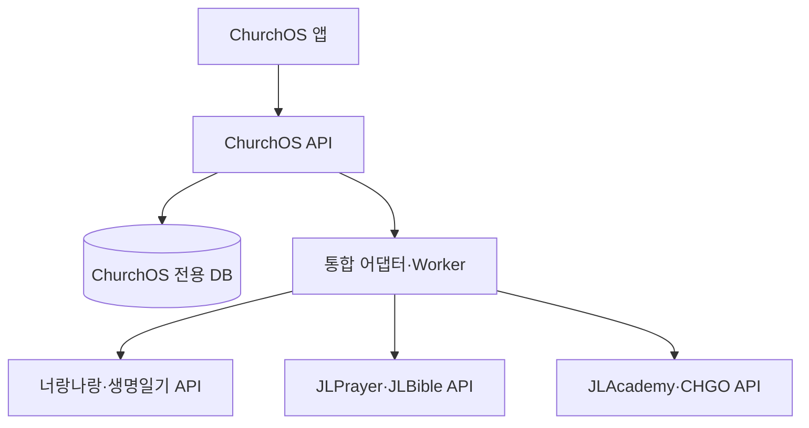

# 독립 제품·API 연결 구조

일곱 제품은 각자 독립 배포한다. ChurchOS 내부에서만 모듈형 모놀리스를 사용한다. 이는 여섯 전문 제품을 ChurchOS 코드나 DB에 넣는다는 뜻이 아니다.

다이어그램에서 묶어 표시한 제품도 각각 별도 API·DB·배포를 갖는다.

ChurchOS 모듈은 tenant, membership, access, community, event, care, ministry, experience, integration, audit로 나눈다. API·Worker·Scheduler는 ChurchOS 코드베이스의 실행 역할이며 별도 최소 DB 권한을 사용한다. domain은 SDK·HTTP·DB를 import하지 않고 application port를 통해 어댑터를 교체한다.

인증 요청은 OIDC 검증→issuer/audience/expiry 검증→교회 소속 확인→역할·목적·동의 검증→트랜잭션 로컬 tenant 설정→도메인 처리→감사 기록 순서다. 서비스별 audience를 가진 토큰을 발급하며 하나의 bearer token을 모든 서비스에 재사용하지 않는다.

전문 API 호출은 timeout·circuit breaker·서비스별 rate limit을 적용한다. 상태·이벤트는 version, correlation ID, idempotency key를 가진다. outbox 재시도와 DLQ를 사용한다. 핵심 저장 트랜잭션에서 외부 API 응답을 기다리지 않는다. webhook은 서명·시각·replay·중복 검증 후 수신한다. 전문 앱이 미구현이면 mock으로 표시하고 실제 연결 성공으로 기록하지 않는다.

공통 계정 기반은 내부 인프라다. UI에는 ChurchOS/교회명과 로그인 행동만 표시한다. 제품 계정 연결은 (issuer, subject, provider, tenant) 경계를 지키고 교회 변경 시 캐시·권한·연동 범위를 다시 검증한다.
