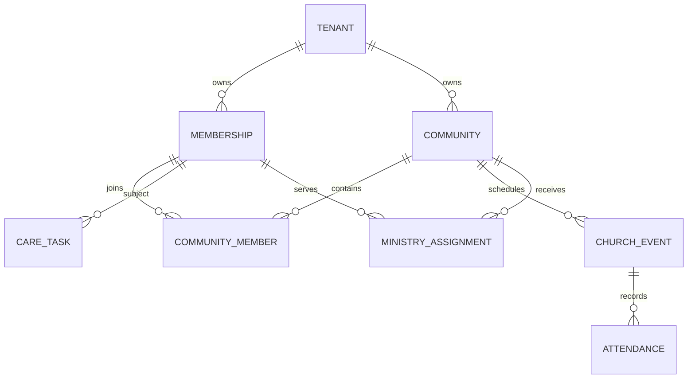

# Church OS 3.0 DB 논리 모델

## 상태

- Artifact ID: COS-DB-LM-001
- Version: 1.0
- Lifecycle: LOGICAL MODEL CANDIDATE
- Target: PostgreSQL 16+
- Execution state: NOT RUN

## 모델링 결정

1. Church OS는 교회 운영 데이터만 소유한다.
2. 모든 tenant 소유 테이블의 기본 식별은 `(tenant_id, id)`다.
3. 모든 tenant 내부 FK도 `(tenant_id, referenced_id)`를 참조한다.
4. 플랫폼 역할 템플릿과 교회 역할을 별도 테이블로 나눈다. nullable tenant를 가진 하나의 role 테이블을 만들지 않는다.
5. 개인 전문 앱 데이터는 `integration_connection`과 opaque reference만 저장한다.
6. 출석·교육·활동량을 성장점수로 변환하는 컬럼을 두지 않는다.
7. `updated_at`과 `row_version`은 실제 트리거 또는 application-enforced optimistic locking으로 갱신해야 한다.
8. 모든 tenant 테이블은 RLS와 `FORCE ROW LEVEL SECURITY` 적용 대상이다.

## 핵심 관계

## 영역별 테이블

| 영역 | 테이블 | 목적 |
|---|---|---|
| tenant | tenant, campus | 교회와 캠퍼스 |
| identity binding | external_subject_binding | 내부 공통 인증·계정 기반 subject와 tenant person 연결 |
| membership | membership | 교회 소속과 상태 |
| access | system_role_template, tenant_role, membership_role | 전역 템플릿과 교회별 역할 분리 |
| community | community, community_member | 목장·그룹·부서·팀 |
| event | church_event, attendance | 예배·행사와 운영 출석 |
| care | care_task | 새가족·연락·심방·지원 workflow |
| mission | ministry_assignment | 자발적 사역·봉사 배치 |
| white-label | brand_config | 제한된 브랜드·모듈 설정 |
| integration | integration_connection, external_state_ref | 전문 앱 연결과 최소 상태 |
| reliability | outbox_event, idempotency_record, handoff_grant | 전달 보장·중복 방지·일회용 전문 앱 연결 |
| governance | audit_event | 목적·행위·결정 중심 감사 |

## 데이터 금지 목록

다음 데이터는 Church OS 테이블에 저장하지 않는다.

- 생명일기 7문항 원문과 자유서술
- JLPrayer 비공개 기도제목·응답 간증·상담 메모
- 너랑나랑 관계 나눔 원문
- 라이선스가 없는 성경 본문
- CHGO 개인 성장 원문, 영적 점수, 고정 성향 라벨
- 비밀번호, OAuth/OIDC 원 토큰, provider secret 평문

## 보안 불변조건

- 세션에서 검증된 tenant가 없으면 tenant 테이블 접근을 거부한다.
- application role과 migration owner를 분리한다.
- application role에는 schema `USAGE`와 필요한 CRUD만 부여한다.
- owner 우회를 막기 위해 tenant 테이블에 `FORCE ROW LEVEL SECURITY`를 사용한다.
- 직접 식별자 대신 외부 시스템별 opaque reference를 저장한다.
- audit payload에는 민감 본문을 허용하지 않는다.
- 삭제·보존 정책은 tenant 운영 데이터와 개인 전문 앱 데이터를 별도로 처리한다.

## 다음 단계에서 필요한 실행 검증

이 논리 모델은 migration이 아니다. 다음 단계에서 V001부터 forward migration으로 변환하고 PostgreSQL 16에서 다음을 실제 검증해야 한다.

1. clean apply와 재실행 정책
2. owner·app role·cross-tenant 음성검사
3. composite FK의 교차 tenant 차단
4. role template 중복 방지
5. updated_at·row_version 갱신
6. outbox 원문 차단
7. dump·drop·restore

